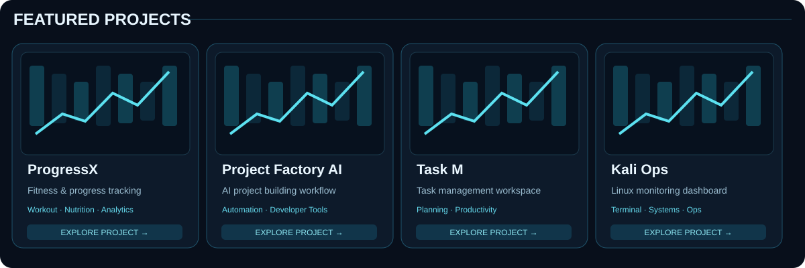

### Full-Stack Developer · Product Engineering · Automation

Building practical software, intelligent workflows and tools that solve real problems.

## ⚡ Build · Solve · Automate · Repeat

<table><tr><td align="center">⌘ <b>Clean code</b> Maintainable solutions</td><td align="center">◈ <b>Real projects</b> From ideas to products</td><td align="center">⚙ <b>Automation</b> Smarter workflows</td><td align="center">↗ <b>Always learning</b> Practical experiments</td></tr></table>

## 🚀 Featured projects

| Project | Source / live experience |
| :--- | :--- |
| **ProgressX** — workout, food and progress tracking | [Source](https://github.com/3bHussein/ProgressXX) · [Live web app](https://3bhussein.github.io/ProgressXX-Web/) |
| **Project Factory AI** — project-building workflow | [Builder](https://3bhussein.github.io/Project-Factory-AI/builder.html) |
| **Task M** — task manager concept in development | [Browse repositories](https://github.com/3bHussein?tab=repositories) |
| **Kali Ops** — Linux terminal dashboard | [Browse repositories](https://github.com/3bHussein?tab=repositories) |

Project artwork is illustrative, not screenshots of running apps. Links to unverified repositories are intentionally not fabricated.

## 🛠️ Tools & technologies

## 📊 GitHub activity

## 👋 About me

I'm El-Hussein, a full-stack developer working remotely since 2018. I build useful software, integrate systems, and automate workflows. My interests include product engineering, Linux operations, and practical DevOps.

---

**Let's build something useful.**

[Connect on LinkedIn](https://linkedin.com/in/elhusseinahmed) · [Browse my work](https://github.com/3bHussein?tab=repositories)

