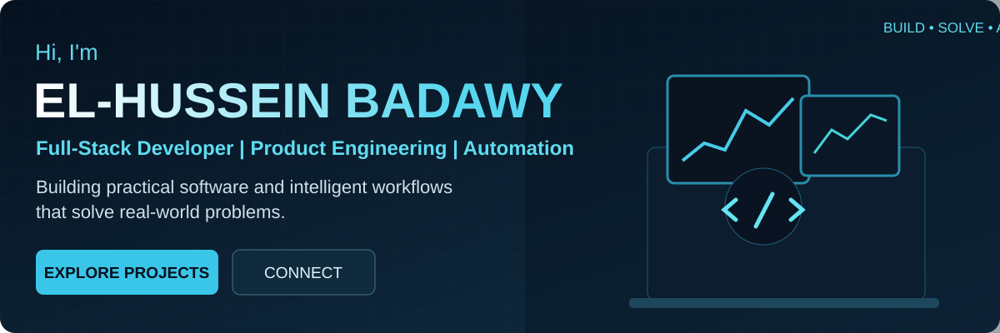
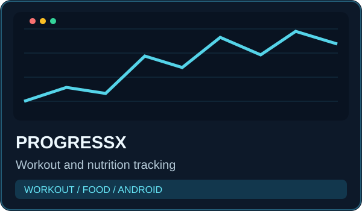
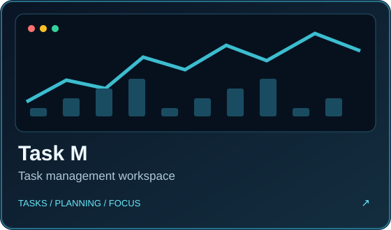
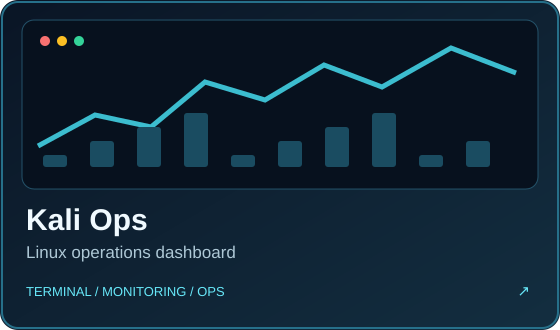
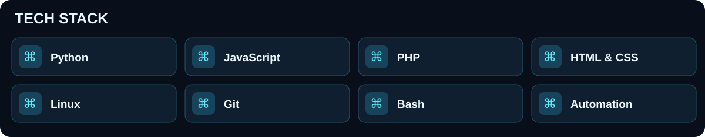

### Full-Stack Developer · Product Engineering · Automation

Building practical software, intelligent workflows and tools that solve real problems.

## ⚡ Build · Solve · Automate · Repeat

<table><tr><td align="center">⌘ <b>Clean code</b> Maintainable solutions</td><td align="center">◈ <b>Real projects</b> From ideas to products</td><td align="center">⚙ <b>Automation</b> Smarter workflows</td><td align="center">↗ <b>Always learning</b> Practical experiments</td></tr></table>

## 🚀 Featured projects

<table><tr><td width="50%" align="center"> <a href="https://3bhussein.github.io/ProgressXX-Web/">Live demo ↗</a> · <a href="https://github.com/3bHussein/ProgressXX">Source code</a></td><td width="50%" align="center"> <a href="https://3bhussein.github.io/Project-Factory-AI/builder.html">Open builder ↗</a></td></tr><tr><td width="50%" align="center"> In development</td><td width="50%" align="center"> Explore repositories</td></tr></table>

Cards are original illustrative artwork, not screenshots. The last two links open the repository listing until a specific public project link is verified.

## 🛠️ Tools & technologies

## 📊 GitHub activity

## 👋 About me

I'm El-Hussein, a full-stack developer working remotely since 2018. I build useful software, integrate systems, and automate workflows. My interests include product engineering, Linux operations, and practical DevOps.

---

**Let's build something useful.**

[Connect on LinkedIn](https://linkedin.com/in/elhusseinahmed) · [Browse my work](https://github.com/3bHussein?tab=repositories)

