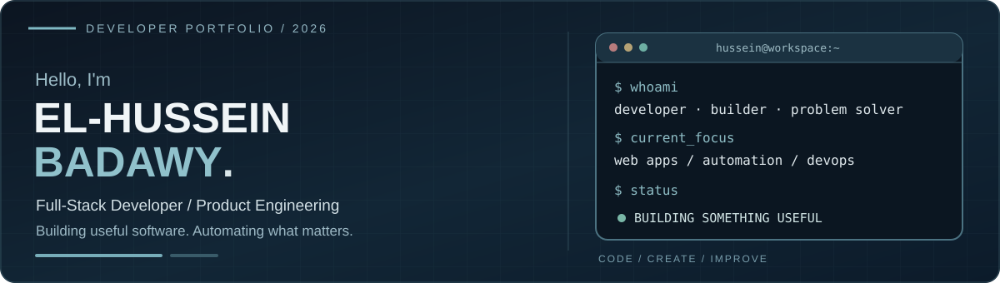

<picture><source media="(prefers-color-scheme: dark)" srcset="./assets/profile-banner-v3.svg"/><source media="(prefers-color-scheme: light)" srcset="./assets/profile-banner-v3.svg"/></picture>

<table><tr>
<td width="25%" align="center"><b>⌘ Clean Code</b> Maintainable solutions</td>
<td width="25%" align="center"><b>◇ Real Projects</b> From ideas to products</td>
<td width="25%" align="center"><b>⚙ Automation</b> Smarter workflows</td>
<td width="25%" align="center"><b>↗ Always Learning</b> Practical engineering</td>
</tr></table>

[**Projects**](#-featured-projects) · [**Tech Stack**](#%EF%B8%8F-tech-stack) · [**GitHub Activity**](#-github-activity) · [**About**](#-about-me)

## 🚀 Featured Projects

<table>
<tr>
<td width="50%" valign="top" align="center">

 <a href="https://github.com/3bHussein/ProgressX">Source code ↗</a>
</td>
<td width="50%" valign="top" align="center">

 <a href="https://github.com/3bHussein/Project-Factory-AI">Source code ↗</a> · <a href="https://3bhussein.github.io/Project-Factory-AI/builder.html">Live builder ↗</a>
</td>
</tr>
<tr>
<td width="50%" valign="top" align="center">

 <a href="https://github.com/3bHussein/vin-decoder-pro">Source code ↗</a>
</td>
<td width="50%" valign="top" align="center">

 <a href="https://github.com/3bHussein/Cinematic-terminal-command-center-for-Kali-Linux">Source code ↗</a>
</td>
</tr>
</table>

<b>More projects</b>

- [3B Nexosuite](https://github.com/3bHussein/3B-nexosuite) — commerce and ERP workflows
- [Automax Academy](https://github.com/3bHussein/Automax-Academy) — training and community portal
- [Bil Hana](https://github.com/3bHussein/Bil_Hana) — bilingual Egyptian recipes

## 🛠️ Tech Stack

<table><tr>
<td width="33%" valign="top" align="center"><b>Frontend</b>      </td>
<td width="33%" valign="top" align="center"><b>Backend</b>     </td>
<td width="33%" valign="top" align="center"><b>DevOps & Tools</b>      </td>
</tr></table>

Technologies from my original profile · Icons by Devicon

## 📊 GitHub Activity

<a href="https://github.com/3bHussein?tab=overview">View official contribution activity ↗</a>

## 👋 About Me

I'm El-Hussein, a full-stack developer focused on building usable products, connecting systems and automating repetitive work. My interests include product engineering, Linux operations and practical DevOps. I prefer shipping useful software over showcasing unfinished concepts.

---

**Let's build something useful.**

[Connect on LinkedIn](https://linkedin.com/in/elhusseinahmed) · [Browse my work](https://github.com/3bHussein?tab=repositories)

