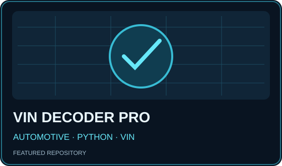

### Full-Stack Developer · Product Engineering · Automation

Building practical software, intelligent workflows and tools that solve real problems.

## ⚡ Build · Solve · Automate · Repeat

<table><tr><td align="center">⌘ <b>Clean code</b> Maintainable solutions</td><td align="center">◈ <b>Real projects</b> From ideas to products</td><td align="center">⚙ <b>Automation</b> Smarter workflows</td><td align="center">↗ <b>Always learning</b> Practical experiments</td></tr></table>

## 🚀 Featured projects — verified repositories

<table>
<tr><td width="50%" valign="top"> <b>ProgressX</b> Workout and nutrition tracking with web and Android builds. <a href="https://github.com/3bHussein/ProgressX">Source code ↗</a></td></tr>
<tr><td width="50%" valign="top"> <b>Project Factory AI</b> Free-first project factory with review workflows, automated tests and runnable tools. <a href="https://github.com/3bHussein/Project-Factory-AI">Source code ↗</a> · <a href="https://3bhussein.github.io/Project-Factory-AI/builder.html">Builder ↗</a></td>
<td width="50%" valign="top"> <b>VIN Decoder Pro</b> Cross-platform vehicle identification number decoding tool. <a href="https://github.com/3bHussein/vin-decoder-pro">Source code ↗</a></td></tr>
</table>

### More real projects

- [**3B Nexosuite**](https://github.com/3bHussein/3B-nexosuite) — PHP/MySQL commerce and ERP workflows.
- [**Kali Ops V1**](https://github.com/3bHussein/Cinematic-terminal-command-center-for-Kali-Linux) — Bash/tmux terminal monitoring command center.
- [**Automax Academy**](https://github.com/3bHussein/Automax-Academy) — training portal and community forum features.
- [**Bil Hana**](https://github.com/3bHussein/Bil_Hana) — bilingual Egyptian recipe website.

Featured selections are based on repository documentation and project scope, not fabricated GitHub rankings. Illustrations are conceptual rather than screenshots.

## 🛠️ My Skill Set

The stack below reflects the technologies in my existing profile, grouped by area rather than adding unrelated tools.

<table>
<tr><th align="center">Frontend</th><th align="center">Backend</th><th align="center">DevOps &amp; Cloud</th></tr>
<tr>
<td align="center" valign="top">

</td>
<td align="center" valign="top">

</td>
<td align="center" valign="top">

</td>
</tr>
</table>

These are tools and technologies represented in the earlier profile; icons do not indicate certification or proficiency level. Linux, Git and Bash are cross-cutting skills.

## 📊 GitHub activity

## 👋 About me

I'm El-Hussein, a full-stack developer working remotely since 2018. I build useful software, integrate systems, and automate workflows. My interests include product engineering, Linux operations, and practical DevOps.

---

**Let's build something useful.**

[Connect on LinkedIn](https://linkedin.com/in/elhusseinahmed) · [Browse my work](https://github.com/3bHussein?tab=repositories)

